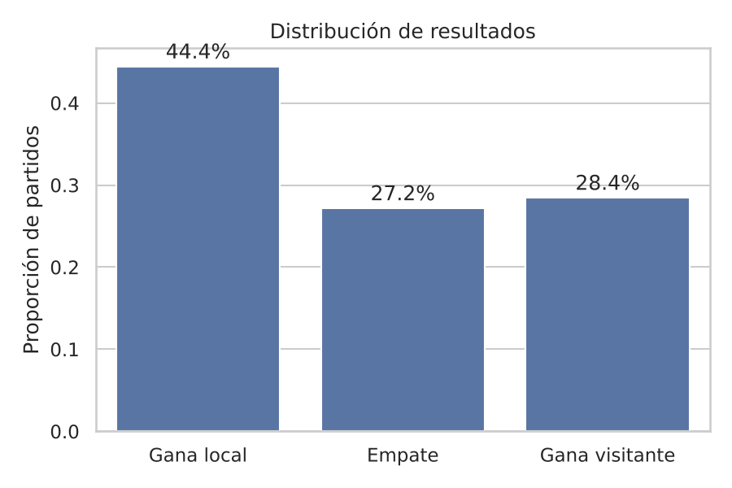
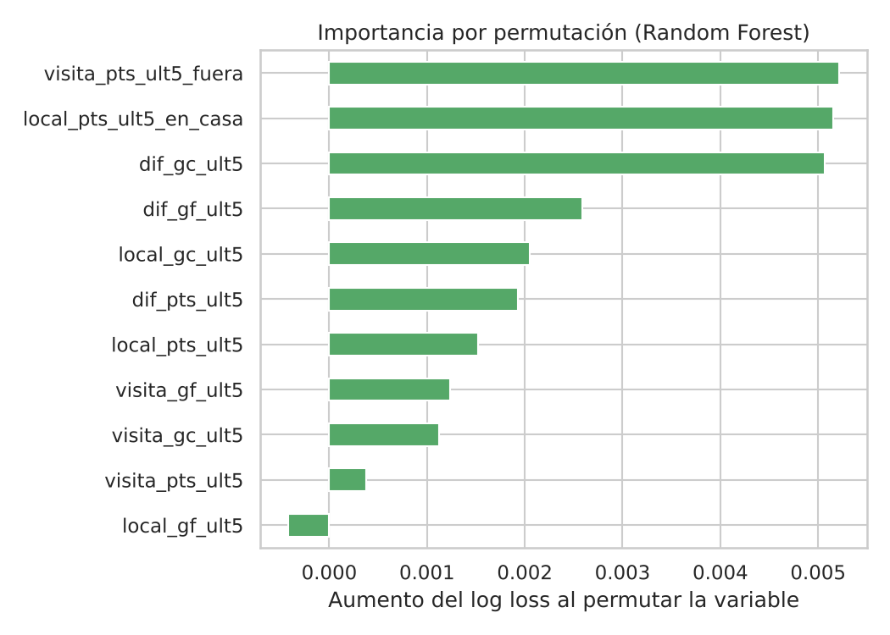
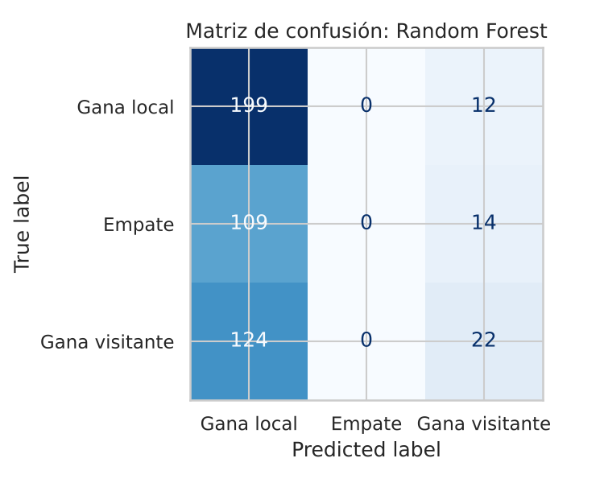

# Predicción de resultados de la Liga MX con machine learning

Modelo de clasificación que estima la probabilidad de victoria local, empate o victoria visitante en partidos de la Liga MX, usando solo información disponible antes de cada partido. Las variables se construyen con SQL (funciones de ventana) y los modelos se evalúan con validación temporal contra dos referencias: predecir siempre "gana el local" y las probabilidades implícitas en los momios de cierre.

## Pregunta

Con la forma reciente de cada equipo y la condición de local, ¿qué tan bien se puede predecir el resultado de un partido de la Liga MX? ¿Se acerca un modelo sencillo a lo que estima el mercado de apuestas?

## Datos

| | |
|---|---|
| Fuente | [football-data.co.uk – México](https://www.football-data.co.uk/mexico.php) (uso libre) |
| Archivo | [`MEX.csv`](https://www.football-data.co.uk/new/MEX.csv) |
| Unidad | Un partido por fila |
| Columnas usadas | `Season`, `Date`, `Home`, `Away`, `HG`, `AG`, `Res` y momios de cierre promedio del mercado (`AvgCH/AvgCD/AvgCA`) |

Descripción de columnas: [notes.txt](https://www.football-data.co.uk/notes.txt). El archivo se descarga automáticamente al ejecutar el notebook, o manualmente con `python src/descargar_datos.py`.

## Metodología

1. **Limpieza:** tipos de dato, nulos, duplicados y verificación de que el resultado coincida con el marcador.
2. **Análisis exploratorio:** distribución de resultados, ventaja de local y tendencias por temporada.
3. **Ingeniería de variables en SQL:** para cada equipo, promedio de puntos, goles a favor y goles en contra en sus 5 partidos anteriores, además de su forma solo de local o solo de visitante. La ventana `ROWS BETWEEN 5 PRECEDING AND 1 PRECEDING` excluye el partido a predecir para evitar fuga de información ([`sql/variables_forma_reciente.sql`](sql/variables_forma_reciente.sql)).
4. **División temporal:** las dos últimas temporadas se reservan como prueba; nunca se entrena con partidos posteriores a los evaluados.
5. **Modelos:** regresión logística, Random Forest y SVM, con hiperparámetros elegidos por `GridSearchCV` + `TimeSeriesSplit`, optimizando log loss.
6. **Evaluación:** accuracy, F1 macro y log loss en temporadas no vistas, matriz de confusión e importancia de variables por permutación.

## Resultados

4,799 partidos (julio 2012 a noviembre 2026). Entrenamiento: 4,271 partidos (2012/2013 a 2024/2025). Prueba: 480 partidos (2025/2026 y lo jugado de 2026/2027).

| Modelo | Accuracy | F1 macro | Log loss |
|---|---|---|---|
| Referencia: momios de cierre | 0.510 | 0.380 | 1.001 |
| **Random Forest** | 0.460 | 0.282 | **1.052** |
| Regresión logística | **0.471** | 0.307 | 1.053 |
| SVM | 0.452 | 0.258 | 1.061 |
| Referencia: siempre local | 0.440 | 0.204 | 1.074 |

**Hallazgos**

- Los tres modelos superan a la referencia "siempre local". La regresión logística alcanza 47.1 % de accuracy (3.1 puntos porcentuales arriba) y Random Forest obtiene el mejor log loss.
- Los momios de cierre siguen siendo mejores (51.0 % de accuracy), algo esperable porque el mercado incorpora alineaciones, lesiones y calidad de plantilla que el modelo no conoce.
- Las variables más útiles son la forma del visitante jugando fuera, la forma del local jugando en casa y la diferencia de goles en contra.
- Ningún modelo predice empates: aunque ocurren en el 27 % de los partidos, casi nunca son el resultado más probable.







## Estructura del repositorio

```
prediccion-resultados-liga-mx/
├── data/
│   └── raw/                  # MEX.csv (se descarga al ejecutar)
├── notebooks/
│   └── prediccion_resultados_liga_mx.ipynb
├── reports/
│   └── figures/              # gráficas generadas por el notebook
├── sql/
│   └── variables_forma_reciente.sql
├── src/
│   └── descargar_datos.py
├── requirements.txt
└── README.md
```

## Cómo ejecutarlo

**Local**

```bash
git clone https://github.com/cast06/prediccion-resultados-liga-mx.git
cd prediccion-resultados-liga-mx
pip install -r requirements.txt
jupyter notebook notebooks/prediccion_resultados_liga_mx.ipynb
```

**Google Colab:** abre el notebook y descomenta la celda de la sección 0 que clona el repositorio.

## Limitaciones

- Solo se usan resultados históricos: no hay datos de alineaciones, lesiones, tiros ni posesión.
- Los empates son la clase más difícil de predecir.
- La prueba incluye la temporada 2026/2027 incompleta y los datos incluyen partidos de liguilla.
- Los torneos cortos (Apertura y Clausura) y los cambios de plantilla entre torneos reducen el valor de la forma reciente en las primeras jornadas.

## Siguientes pasos

- Rating tipo Elo por equipo como variable adicional.
- Estadísticas de partido (tiros, tiros a puerta) si se consigue una fuente confiable.
- Modelos de boosting (XGBoost, LightGBM) y calibración de probabilidades.

## Herramientas

Python · pandas · NumPy · SQL (SQLite) · scikit-learn · matplotlib · seaborn

## Autora

**Sharon Xolocotzi Castillo**, estudiante de Ciencia de Datos en la ESCOM-IPN
[LinkedIn](https://www.linkedin.com/in/sharon-xolocotzi-castillo-b89aa12b8) · [GitHub](https://github.com/cast06)
